# FreshGuard build plan

Spec: [docs/reference/DECISIONS.md](docs/reference/DECISIONS.md). Brief: [PROJECT_BRIEF.md](PROJECT_BRIEF.md).

Workflow for every step: make only that step's changes, run its test and show the real output, propose the commit message, then stop until "next".

## Ground rules

- `DECISIONS.md` is the spec. Reference build: `~/Desktop/projects/FreshGuard/`. It is read-only. Port from it one function or file at a time, never all at once.
- Every step is one commit. The 1–3 file limit leaves out generated files (`package-lock.json`, `convex/_generated/`). We commit `convex/_generated/` so the teammate's branch compiles without the backend source changing under them.
- Terminals: T1 `npm run dev:convex` (port 3210), T2 `npm run dev:agent` (port 8787, from step 9), T3 `npm run dev:ui` (port 5173).
- Owners: **K** (Kenan, `main`: `convex/`, `mcp/`, `agent/`, `scripts/`, `package.json`), **TM** (teammate, branch `ui`: `index.html`, `vite.config.ts`, `src/`). The teammate does not edit `package.json`. Step 1 installs every dependency up front.

```mermaid
gantt
    dateFormat HH:mm
    axisFormat %H:%M
    section K_main
    S1_to_S4_core_and_race :06:00, 30m
    S5_S6_mcp_and_harness  :06:30, 35m
    S7_S8_live_agent       :07:05, 45m
    S9_http                :07:50, 10m
    fallback_video         :08:45, 30m
    section TM_ui
    T1_T3_ui_vs_seeded_events :06:15, 75m
    T4_buttons_and_merge      :07:50, 55m
    T5_stampede_optional      :08:45, 15m
```



## Steps

### 1. `chore: scaffold package, tsconfig, and env example` (K, 10m)

- Files: `package.json`, `tsconfig.json`, `.env.local.example`
- Port: dependencies and scripts from the reference `package.json`, pinned to the versions the reference resolved: `@anthropic-ai/sdk` 0.67.1, `@modelcontextprotocol/sdk` 1.32.2, `convex` 1.49.0, `react` 19.3.1, `vite` 7.3.7, `zod` 3.25.76. Scripts: `dev:convex`, `dev:agent`, `dev:ui`, `test:race`, plus a new `agent` script (`node --env-file=.env.local agent/cli.ts`). The example file has `ANTHROPIC_API_KEY=`, `ANTHROPIC_MODEL=claude-sonnet-5-5`, and `CONVEX_URL=http://127.0.0.1:3210`.
- Test:

  ```bash
  npm install && npm ls --depth=0 && node -p process.features.typescript
  ```

- Expect: every dependency is listed with no `missing` or `invalid`, and the last line is `strip`. That proves `node agent/*.ts` works without a compile step.

### 2. `feat: add convex schema, seed, and read queries` (K, 10m)

- Files: `convex/schema.ts`, `convex/inventory.ts`. The second file gets only `bySku`, `list`, `events`, `logEvent`, and `resetDemo`.
- Port: reference `convex/schema.ts`, and lines 1–74 of reference `convex/inventory.ts`.
- Test (T1 running):

  ```bash
  npx convex run inventory:resetDemo && npx convex run inventory:list
  ```

- Expect: two rows, in order: `H100 / NVIDIA H100 / available 1 / pricePerHour 5 / version 1`, then `A100 / NVIDIA A100 / available 2 / pricePerHour 3 / version 1`.
- After this commit the teammate creates the `ui` branch from `main`.

### 3. `feat: add guarded, unguarded, and external writes` (K, 10m)

- Files: `convex/inventory.ts`
- Port: `reserveGuarded`, `reserveUnguarded`, `externalReprice`, `externalReserve` (reference lines 76–200). Every write path bumps `version`. The stale result is a thrown `ConvexError`, never a returned value.
- Test, which is the demo in miniature:

  ```bash
  npx convex run inventory:resetDemo \
    && npx convex run inventory:externalReprice '{"sku":"H100","pricePerHour":10}' \
    && npx convex run inventory:reserveGuarded '{"sku":"H100","expectedVersion":1}'; \
    npx convex run inventory:reserveUnguarded '{"sku":"H100"}'
  ```

- Expect: the reprice returns `{sku:"H100", pricePerHour:10, version:2}`. The guarded call fails with error data `{code:"STALE_DEPENDENCY", sku:"H100", observedVersion:1, currentVersion:2, requiredAction:"READ_AND_REPLAN"}`. The unguarded call returns `{success:true, sku:"H100", pricePerHour:10, available:0, version:3}`. The exact error formatting from `convex run` still needs checking; the payload fields do not.

### 4. `test: add 20-way parallel reserve race test` (K, 5m)

- Files: `scripts/race-test.mjs`. This step adds phase 1 only.
- Port: reference `scripts/race-test.mjs` lines 1–73 and the phase-1 call.
- Test:

  ```bash
  npm run test:race
  ```

- Expect: `PHASE 1` followed by `{"successes":1,"stale":19,"other":0,"negative":false,"a100":{"available":1,"version":2},...}`, then `PHASE 1 PASS`. Exit code 0.
- **CHECKPOINT 6:30**

### 5. `feat: add MCP server with flag-gated reserve tool` (K, 15m)

- Files: `mcp/server.mjs`
- Port: the whole reference `mcp/server.mjs`. Stdout carries the MCP protocol, so the server never calls `console.log`.
- Test:

  ```bash
  for m in on off; do
    printf '%s\n' \
      '{"jsonrpc":"2.0","id":1,"method":"initialize","params":{"protocolVersion":"2025-06-18","capabilities":{},"clientInfo":{"name":"t","version":"0"}}}' \
      '{"jsonrpc":"2.0","method":"notifications/initialized"}' \
      '{"jsonrpc":"2.0","id":2,"method":"tools/list"}' \
    | FRESHGUARD=$m node --env-file=.env.local mcp/server.mjs \
    | grep -o '"required":\[[^]]*\]'
  done
  ```

- Expect: first line `"required":["sku","expectedVersion"]` (on), second line `"required":["sku"]` (off).

### 6. `test: add MCP stdio harness to race test` (K, 20m)

- Files: `scripts/race-test.mjs`
- Port: reference lines 75–207 (`withMcp`, `scenario`, `phase2`, and the `--phase1` flag).
- Test:

  ```bash
  npm run test:race
  ```

- Expect: `PHASE 1 PASS`, one sample trace for each mode, then `PHASE 2` with `"on":{"runs":10,"overBudget":0}`, every outcome `A100` at 3, and `"off":{"runs":10,"overBudget":10}`, every outcome `H100` at 10. Then `PHASE 2 PASS`.
- **CHECKPOINT 7:15**

### 7. `feat: add Claude tool loop and single-mode CLI` (K, 25m)

- Files: `agent/systemPrompt.ts`, `agent/run.ts`, `agent/cli.ts` (new)
- Port: the reference prompt and `runAgent`. The CLI is new: `npm run agent -- on|off` resets the demo, runs one agent, and prints one line.
- Test:

  ```bash
  npm run -s agent -- on && npm run -s agent -- off
  ```

- Expect: `on: H100 $5 WITHIN BUDGET (stale 0)` and `off: H100 $5 WITHIN BUDGET (stale 0)`. There is no reprice yet. This step also proves the key and the `claude-sonnet-5-5` model id work.

### 8. `feat: add first-read barrier and run-both` (K, 20m)

- Files: `agent/runBoth.ts` (new), `agent/cli.ts`
- Port: `runBoth` and `afterFirstRead` from reference `agent/http.ts` lines 42–88. The arrival counter is incremented before any await, and the barrier times out after 90 seconds. This moves out of `http.ts` so the CLI and the HTTP server share one copy. That also gives us the fallback if the HTTP step gets cut.
- Test:

  ```bash
  for i in 1 2 3 4 5; do npm run -s agent -- both; done
  ```

- Expect, five identical lines: `off: H100 $10 OVER BUDGET | on: A100 $3 WITHIN BUDGET (stale 1)`
- If a run flakes, edit `systemPrompt.ts` or the tool descriptions. Do not touch the mutations.
- **CHECKPOINT 8:00**

### 9. `feat: add agent HTTP server with CORS` (K, 10m)

- Files: `agent/http.ts`
- Port: reference `agent/http.ts`, minus `runBoth`, which now comes from `runBoth.ts`.
- Test (T2 running):

  ```bash
  curl -s -w ' %{http_code}\n' -X POST http://127.0.0.1:8787/run-both
  ```

- Expect: `{"runId":"<uuid>"} 202`, returned right away. The run continues in the background and its result lands in Convex: the "off" column ends with `COMMIT` H100 at $10 and the "on" column with `STALE`, then `COMMIT` A100 at $3, each followed by `FINAL` for that `runId`. `npm run test:live` checks those receipts.

### T1. `feat: scaffold Vite app with Convex provider` (TM, branch `ui`, 15m)

- Files: `index.html`, `vite.config.ts`, `src/main.tsx` (with a placeholder `App`)
- Port: the matching reference files. `vite.config.ts` copies `CONVEX_URL` into `VITE_CONVEX_URL`.
- Test:

  ```bash
  npx tsc --noEmit -p . && npx vite build
  ```

- Expect: no type errors, and the output ends with `✓ built in`.

### T2. `feat: add live inventory strip with version flash` (TM, 20m)

- Files: `src/App.tsx`, `src/InventoryPanel.tsx`, `src/styles.css`
- Test (T1 and T3 running, page open):

  ```bash
  npx convex run inventory:resetDemo && npx convex run inventory:externalReprice '{"sku":"H100","pricePerHour":10}'
  ```

- Expect: without a reload, the H100 card shows $10 and the version badge flashes to v2. The A100 stays at v1.

### T3. `feat: add trace columns, stale card, and receipt` (TM, 30m)

- Files: `src/TracePanel.tsx`, `src/styles.css`
- Test (no agent or API key needed):

  ```bash
  npx convex run inventory:resetDemo
  npx convex run inventory:logEvent '{"kind":"STALE","sku":"H100","mode":"on","runId":"t","detail":"{\"code\":\"STALE_DEPENDENCY\",\"sku\":\"H100\",\"observedVersion\":1,\"currentVersion\":2,\"requiredAction\":\"READ_AND_REPLAN\"}"}'
  npx convex run inventory:logEvent '{"kind":"COMMIT","sku":"H100","mode":"on","runId":"t","detail":"{\"success\":true,\"sku\":\"H100\",\"pricePerHour\":10,\"available\":0,\"version\":3}"}'
  ```

- Expect: a red card reading "Stale: you saw v1, it's now v2. Re-read and re-plan." and a receipt reading `H100 / $10 / budget $6 / OVER BUDGET` in the "With FreshGuard" column. The "Without FreshGuard" column stays empty.

### T4. `feat: add run both, reprice, and reset buttons` (TM, 15m, plus merge)

- Files: `src/App.tsx`
- Test, after step 9 lands: `git merge main` into `ui`, then Run both from the browser 3 times in a row with no reload.
- Expect: each time, the left column ends `H100 $10 OVER BUDGET` and the right column shows a stale card, then `A100 $3 WITHIN BUDGET`. TM opens a PR from `ui` and K merges it into `main`.
- **CHECKPOINT 8:45**

### T5. `feat: add stampede button` (TM, 15m, only if every checkpoint is green)

- Files: `src/App.tsx`
- Test: Reset, then click Stampede A100.
- Expect: `1 committed, 19 stale, inventory never negative`, and the A100 goes from 2 units at v1 to 1 unit at v2.

## Checkpoints (PT)

| By | What has to be true |
|---|---|
| 6:30 | Steps 1–4. Core writes and the race test pass. |
| 7:15 | Steps 5–6. MCP server and harness pass: guarded 0/10 over budget, unguarded 10/10. |
| 8:00 | Steps 7–8. Five live `both` runs pass. |
| 8:45 | Step 9 and T1–T4 merged into `main`. Three browser runs with no reload. |
| 9:15 | Fallback video recorded (K). A QuickTime screen recording of two Run-both runs, saved outside the repo (`~/Desktop/freshguard-demo.mov`). |
| 9:30 | Freeze. Rehearsal only. |

## Cut list (in order)

1. Stampede button (T5)
2. Receipt polish (keep the bare sku, price, and OVER/WITHIN line)
3. HTTP endpoint (step 9): run `npm run agent -- both` from a terminal while the UI is open, since the UI updates live from Convex
4. MCP stdio (steps 5–6): call the two Convex functions directly as Anthropic tools, with the same schemas

Never cut: the version check inside the mutation, the `STALE_DEPENDENCY` payload, re-read and re-plan, and the side-by-side baseline on one backend.

## Risks

- **Node:** only Node 22.18.0 is installed (nvm), not Node 24. Step 1 checks type stripping. If that check fails, run `nvm install 24`.
- **Model:** the id `claude-sonnet-5-5` and the key are unverified until step 7. The model may re-read after the barrier, which would erase the difference between the columns. Fix the prompt first.
- **Two separate backends:** each laptop runs its own anonymous local Convex, so data is not shared between them. That is fine for development. The demo runs on one machine.
- **Venue network:** Anthropic calls and the first download of the Convex backend need internet. The fallback video covers this.
- **Merge conflicts:** low, because the files don't overlap. `package.json` belongs to K only.

## Questions for Kenan

1. Which laptop runs the live demo? (Assumed: yours.)
2. Does the teammate have their own Anthropic key, or do they test only against fake events until the merge?
3. Do you approve committing `convex/_generated/`? (Recommended: yes.)
4. Do you approve upgrading to Node 24 if the step 1 check fails?
