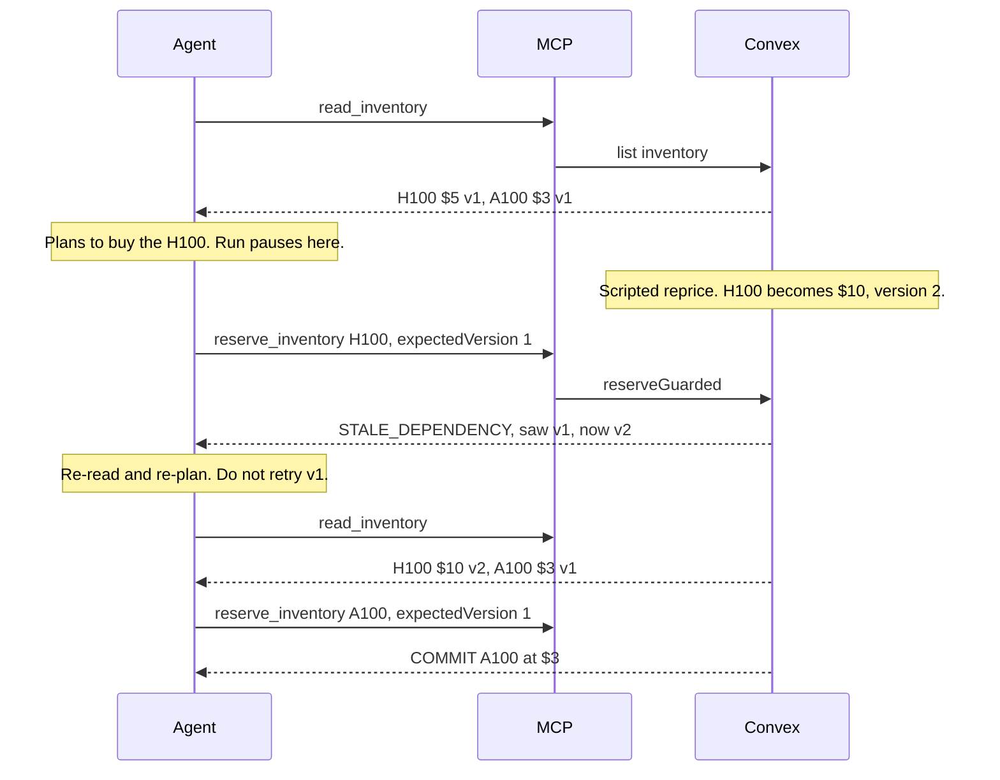

# FreshGuard

Stripe idempotency keys stopped duplicate charges; FreshGuard stops stale ones.

An agent reads the world, thinks, then writes. The write is often based on a snapshot that is no longer true: a price moved, the last unit sold, or someone else edited the record. Most MCP tools still accept that write.

This repo is the research and the build plan for Founders Inc. NightHack (Friday, October 30, 2026, demos at 10:00 PM, no slides). Application code is not here yet. When the docs disagree, [docs/reference/DECISIONS.md](docs/reference/DECISIONS.md) wins.

## 1. The problem

An agent calls a tool, gets an answer, and keeps that answer in its context while it reasons. The source can change during those seconds. The model does not know. It then takes an action that was justified by a fact that is no longer true. That is a check-then-act race. Today's agent runtimes mostly do not tell the model that an old observation has gone stale, and most MCP write tools do not check it either. They just write.

Three concrete cases from the notes:

- A buyer agent reads "H100, $5/hr, one left," spends time choosing, and reserves it after the seller has already moved the price to $10. The charge goes through on the new price. That is the demo in [docs/reference/CURSOR_PROMPT.md](docs/reference/CURSOR_PROMPT.md).
- A support agent reads a $100 balance, thinks about policy for about 30 seconds, and approves a $50 refund after the customer has withdrawn the $100. The account goes negative. That example is in [docs/gemini_docs/vc_pitch_api_logistics.md](docs/gemini_docs/vc_pitch_api_logistics.md).
- An agent reads a config or a ticket, a human ships a hotfix or closes the ticket, and the agent writes back on top of the new state. The DevOps version of this is in [docs/gemini_docs/freshguard_master_blueprint.md](docs/gemini_docs/freshguard_master_blueprint.md). The Concord paper uses the same shape for a file: the agent records an old free-shipping threshold, the file is edited out of band, and the agent answers from the old number (`docs/when_agent_context_goes_stale.pdf`).

Holding a database lock across the thinking time is the wrong fix. The model call is slow, and a Convex mutation cannot call out to a model. The gap has to be crossed by carrying the observation forward and checking it at the moment of the write.

## 2. The idea

FreshGuard is a freshness guard for AI agent writes over MCP.

Every read returns the data plus a `version`. Every write must send back the `expectedVersion` the agent actually saw. One atomic check compares them. If they match, the write commits and the version goes up by one. If they do not, the write does not happen, and the caller gets a structured error:

```json
{
  "code": "STALE_DEPENDENCY",
  "sku": "H100",
  "observedVersion": 1,
  "currentVersion": 2,
  "requiredAction": "READ_AND_REPLAN"
}
```

The required action is read again and make a new plan. It is not "retry the same call." Retrying the same version fails the same way.

The pitch line: Stripe idempotency keys stopped duplicate charges; FreshGuard stops stale ones.

Older notes sometimes say `version_id`, reserve by Convex document id, or call the error `STALE_CONTEXT`. We do not follow those. The build uses `version`, lookup by `sku`, and `STALE_DEPENDENCY`. That is fixed in `DECISIONS.md` and the Cursor prompt.

## 3. How it works in detail

### Data

Two tables, both in Convex.

`inventory` is indexed by `sku`. Each row has `sku`, `name`, `available` (a count), `pricePerHour`, and `version` (an integer). The demo seed is H100, 1 unit, $5/hr, version 1, and A100, 2 units, $3/hr, version 1. `_creationTime` is not a version. It does not change when a row is updated, so a reprice would be invisible.

`events` is a short log: `kind`, optional `sku`, `detail`, optional `mode` (`on` or `off`), optional `runId`. The UI reads the latest 30. Kinds are `COMMIT`, `EXTERNAL`, `READ`, `TOOL_CALL`, `STALE`, and `FINAL`.

Every write bumps `version`: a guarded reserve, an unguarded reserve, a reprice, and an outside buyer. If any path patches a row and forgets the bump, the guard is useless.

### Guarded and unguarded writes

Both writes live in one Convex mutation. The mutation reads the row, checks that at least one unit is left, decrements `available`, bumps `version`, and inserts a `COMMIT`. The price stored on that commit is the price on the row at commit time, which is the price the buyer actually pays.

`reserveGuarded` does one extra step before any write: if `item.version` is not `expectedVersion`, it throws `ConvexError` with the payload above. A throw aborts the mutation, so the stock does not change and a `STALE` row cannot be inserted inside that same mutation. The agent logs `STALE` afterwards, from outside. Returning `{ error: "..." }` would be wrong, because a return commits.

`reserveUnguarded` is the same write with the version compare removed. It still refuses to drive stock below zero, and it still bumps the version. The baseline is "no freshness check," not "no rules." Both modes hit the same backend. The only difference is whether the write carries `expectedVersion`.

Convex already serializes each mutation and will rerun one if a document it read was committed by someone else first. That does not solve this problem. The agent's observation happened in an earlier call, seconds ago. FreshGuard passes that old version in as an argument. If Convex reruns the mutation, the compare runs again, still fails, and still throws. The throw is deterministic, so the rerun cannot "succeed" its way past a stale fact.

An outside seller is just another mutation: `externalReprice` changes `pricePerHour` and bumps `version`. `externalReserve` decrements stock and bumps `version`. Neither one knows about the agent.

### MCP tools

The server is a stdio process using `@modelcontextprotocol/sdk`. It exposes two tools, and nothing else.

`read_inventory` is read-only. It returns JSON text: `{ items: [{ sku, name, available, pricePerHour, version }] }`.

`reserve_inventory` depends on the env flag `FRESHGUARD`, read once when the process starts. `on` requires `{ sku, expectedVersion }` and the description tells the model to pass the version from the read it decided on, and to re-read after `STALE_DEPENDENCY` instead of retrying. `off` accepts `{ sku }` only. Errors come back as `isError: true` with the JSON payload. A raw exception would not show up in the model as a named error, so the tool catches it and serializes it.

### Agent loop

`runAgent(mode, runId)` starts Claude with `ANTHROPIC_MODEL` from the environment, spawns the MCP server with `FRESHGUARD` set to that mode, lists the tools, and maps them to Anthropic tool definitions. It loops until the model stops calling tools, at most 8 turns. Each step is logged with `mode` and `runId`.

The task is fixed: buy the best GPU you can afford, budget $6 per hour, meaning the in-stock GPU with the highest price that is still at most $6. The prompt says read once, pass the version if the tool has one, and on `STALE_DEPENDENCY` read again and re-plan. It also says a successful reserve is final, so the model does not "fix" an overspend by buying a second GPU. The receipt uses the commit, not the model's sentence.

`POST /run-both` resets the demo, then runs `off` and `on` in parallel on one `runId`. After each agent's first read returns, the run pauses before that snapshot is handed back. When both have read, the server reprices the H100 to $10, then both continue. They still see the old snapshot (H100 at $5, version 1). A fresh read at that moment would show $10, and the stale write would never be attempted.



The unguarded agent takes the same first snapshot and the same reprice, then calls `reserve_inventory` with only the sku. That write commits the H100 at $10.

## 4. The demo

Left to right, or top to bottom: live inventory with a version badge, then two columns, "Without FreshGuard" and "With FreshGuard."

The story, said out loud: the agent has $6 an hour and wants the best GPU it can afford. It sees the H100 at $5 and the A100 at $3, so it plans on the H100. While it is holding that snapshot, the seller moves the H100 to $10. Say that the reprice is scripted. The agent's reaction is live. Both columns use the same backend and the same model. Only `expectedVersion` differs.

The unguarded column ends on the H100 at $10, over the $6 budget. The guarded column gets the red card ("Stale: you saw v1, it's now v2. Re-read and re-plan."), reads again, and buys the A100 at $3, within budget. Each column ends in a receipt: GPU, price paid, budget $6, and OVER BUDGET or WITHIN BUDGET. Price paid is the price at commit time, not the price the model remembers.

There is a second beat if the main path is solid: a button fires 20 parallel guarded reserves of the A100, all carrying the same version. Exactly one commits. The other 19 get `STALE_DEPENDENCY`. Stock never goes negative. That is true even when two units are in stock, because the first commit bumps the version and the rest no longer match.

A manual "Reprice H100 → $10" button exists for a narrated walkthrough. The main "Run both" button does the reprice itself, after both first reads.

One integrity rule from the pitch notes: do not script the unguarded agent to say the wrong thing. It uses the real unguarded write. If it somehow recovers anyway, that is what the demo shows. `DECISIONS.md` records the measured no-model gates from a local build: 1 success and 19 stale on the stampede, and on the scripted policy, guarded 0/10 over budget (A100 at $3) and unguarded 10/10 over budget (H100 at $10). The live model gate (five `/run-both` runs) was not run there, because no API key was set.

## 5. Why it matters

The hackathon demo is a purchase. An agent is checking out a GPU against a budget, and a price change during thinking is the whole bug. That is the first market we are showing: agent-initiated buying, where the thing being bought can change between the read and the pay. The same shape shows up anywhere an agent books inventory or freight. The supply-chain version in the VC notes is an agent that sees 500 laptops and books a truck, while another agent buys the laptops first ([docs/gemini_docs/vc_pitch_api_logistics.md](docs/gemini_docs/vc_pitch_api_logistics.md)).

Payments operations are the second story, not the demo we are building tonight. The slide outline lists Payments next to Inventory, Bookings, CRM, Calendars, and workflow state ([docs/chatgpt-docs_2.0/05_slide_outline.md](docs/chatgpt-docs_2.0/05_slide_outline.md)). The VC notes use a refund: read a $100 balance, approve a $50 refund after the money is gone. A later dependency sketch treats a budget row as its own versioned fact, checked beside the GPU. We are not building that tonight.

Two notes in the docs disagree with a "trade faster" pitch, and we follow the disagreement. The post-hackathon roadmap rejects high-frequency trading: if the model takes seconds and the market moves in milliseconds, every write is stale and the agent livelocks ([docs/gemini_docs/freshguard_post_hackathon_roadmap.md](docs/gemini_docs/freshguard_post_hackathon_roadmap.md)). That same note also rejects reimplementing git, and it prefers cloud quota management (a shared GPU pool with no merge conflict on the cloud API). The VC note instead suggests swapping the demo UI for a fintech balance. We do not. `DECISIONS.md` keeps the GPU purchase.

The numbers we can actually cite are about stale context and about MCP quality, not about a purchasing market size. Nobody in these docs published a dollar TAM.

- ConcordBench-Pioneer, 40 tasks, three models, no protection: Claude Sonnet 5 recovered 20/40 (50%), GLM 5.2 recovered 15/40 (37.5%), DeepSeek V4 Pro recovered 24/40 (60%). With Concord, all three reached 40/40, using 46.4% fewer tokens than the strongest non-oracle baseline. Source: the Concord paper, and the same figures in [docs/Perplexity_docs/FreshGuard — Market Validation.md](docs/Perplexity_docs/FreshGuard%20%E2%80%94%20Market%20Validation.md) and [docs/chatgpt_docs/01_market_validation.md](docs/chatgpt_docs/01_market_validation.md). Do not say agents fail half the time in production. The ChatGPT note is explicit: this is a benchmark built to create the race.
- On Claude in that writeup, an alert alone reached 65% and a diff reached 90%, against Concord at 100%. Telling the model "something changed" is weaker than enforcing the write. Source: `docs/chatgpt_docs/01_market_validation.md`.
- ToolBench (Arcade, spec baseline 2026-07-28): 92,923 MCP servers and 641,511 tools. The Perplexity note says 70% of servers give agents no guidance when a call fails, and 83% of 29,341 destructive tools ship without safety annotations; 50,441 servers graded F and 57 graded A+. The ChatGPT note is slightly sharper on the same benchmark: 70.2% (64,106 servers) and "roughly 83%." Cite it as weak recovery guidance, not as a stale-write rate. ToolBench does not measure stale data. Sources: those two files, and https://toolbench.arcade.dev/.

## 6. Prior art and evidence

The mechanism is not new. Databases have had compare-and-swap and optimistic concurrency for decades. The gap is a standard way for an MCP write to declare "I am acting on this version," and a structured error that means re-read and re-plan rather than retry. The competitive note says the comparison does not prove the market is empty.

**When Agent Context Goes Stale** (`docs/when_agent_context_goes_stale.pdf`, arXiv:2610.05281v2, 6 Oct 2026, Liu, Fang, and Qian). Tool results are snapshots. Users, other agents, and external tools can change the source while the model still holds the old text. Concord links each observation to its source, notices the change, and can refresh, annotate, or suppress the stale block before the model sees it again. On their 40-task file benchmark, Concord matched the oracle recover count (40/40 on each of three models) and used 46.4% fewer tokens than the strongest non-oracle baseline. The authors say that 40/40 is not workload-independent reliability, the prototype watches `apply_patch` rather than every out-of-band edit, and Concord does not rewrite the plan that was already made from the stale fact. That is the opening for FreshGuard: Concord repairs what the agent reads. FreshGuard stops the write.

**Real Faults in MCP Software** (`docs/real_faults_in_mcp.pdf`, arXiv:2603.05637v2, 3 Aug 2026, Taraghi, Morovati, and Khomh). They clustered 3,282 bug-related closed GitHub issues from MCP server repos down to a few hundred MCP-related issues, then labeled them (419 labels). Five buckets: Server/Tool Configuration (31.74%), Server/Host Configuration (28.64%), Server Setting (27.45%), Documentation (6.92%), and General Programming (5.25%). In their practitioner survey, tool response handling was the most common fault they hear about (66.67%). The paper is about bugs in servers, not about stale prices. What it supports is narrower: MCP failures sit on the boundaries between host, tool, and server, and a bad or underspecified tool response is what people actually hit. A named `STALE_DEPENDENCY` payload is a response contract. It is not a claim this paper measured. The logistics note links this arXiv id without summarizing it.

Related work the docs name, with their links:

| Work | What the docs say it does | Link in the docs |
|---|---|---|
| Concord | Context coherence. No action-level compare-and-swap. | https://arxiv.org/abs/2610.05281 and https://arxiv.org/html/2610.05281v2 |
| MCP fault taxonomy | The PDF above. The logistics file only drops the link. | https://arxiv.org/abs/2603.05637 |
| Microsoft MCP firewall (Entra, preview) | Allow or block servers, tools, and protocol versions. No versioned commit. | https://learn.microsoft.com/en-us/entra/global-secure-access/how-to-configure-mcp-firewall |
| Cloudflare MCP authorization | OAuth and scopes. The docs say `requiredScopes` are advertised, not enforced, and there is no state precondition. | https://developers.cloudflare.com/agents/model-context-protocol/authorization/ |
| selfheal-mcp | Retry with backoff, circuit breakers, metrics. The inspected repo does not repair payloads or check preconditions. Blind retry can repeat a non-idempotent write. Early repo (6 commits, 0 stars in that note). | https://github.com/carsonroell-debug/selfheal-mcp |
| Human approval (OpenAI Agents SDK and a design guide) | A person approves the call. Approval is of the call, not of whether the facts behind it are still true. The guide suggests re-checking, as advice, not as a transaction. | https://openai.github.io/openai-agents-js/guides/human-in-the-loop/ and https://agentexperience.tech/insights/approval-is-a-workflow/ |
| Portal (Clusy) | The roadmap says Portal protects an agent's compute from OOMs and preemption. FreshGuard is aimed at the opposite edge: the world the agent writes into. | Named in `docs/gemini_docs/freshguard_post_hackathon_roadmap.md`. That file does not give a URL. |
| Convex OCC, mutations, application errors | The substrate. OCC makes one mutation serializable. It does not validate an observation from a previous tool call. | https://docs.convex.dev/database/advanced/occ , https://docs.convex.dev/functions/mutation-functions , https://docs.convex.dev/functions/error-handling/application-errors |

One line from the competitive note, for judges: firewalls decide whether a call may run; retry proxies decide whether to repeat a call; FreshGuard decides whether the world that justified the call still exists.

## 7. Tech stack

Node 22 or newer. TypeScript where it is easy. ESM.

Convex, local and anonymous. `npx convex dev` downloads a local backend (port 3210) and does not need an account or a cloud deploy. The UI uses `convex/react`.

MCP via `@modelcontextprotocol/sdk` (the 1.x package named in the prompt, not the split v2 packages). `zod` for tool arguments.

Claude via `@anthropic-ai/sdk`. The model id is not hardcoded. `CURSOR_PROMPT.md` and `DECISIONS.md` both say to read `ANTHROPIC_API_KEY` and `ANTHROPIC_MODEL` from `.env.local`. For this build, set `ANTHROPIC_MODEL` to `claude-sonnet-5-5`. The logistics note says "use Claude 3.5 Sonnet." We do not follow that. Concord's benchmark model "Claude Sonnet 5" is a paper result, not our API id.

Vite and React for the UI. Plain CSS, no component library.

The logistics note is right about the sponsors and wrong about the model pin: Anthropic ($50 API credits per builder, $10,000 in prize credits for top teams), Convex, Bolt, and Firecrawl. Event page: https://luma.com/nighthack. About 312 people, build 5:00–10:00 PM, demos 10:00–11:00 PM, no slides. Judges score what is built during the sprint.

## 8. Build plan

Code is not in this repo. Build it in order, and do not start the next piece until the checkpoint holds. Clock for tonight:

| By | What has to be true |
|---|---|
| 6:00 PM | Schema, seed, guarded and unguarded reserve, reprice. Twenty parallel guarded writes: 1 commit, 19 stale, stock never negative. |
| 6:45 PM | MCP `read_inventory` and `reserve_inventory`, flag on and off. Scripted reprice between read and write, 10 runs each. Guarded never over $6. Unguarded always pays $10 for the H100. |
| 7:45 PM | Claude loop, both modes, barrier, then the reprice. Five `/run-both` runs: unguarded ends on H100 at $10, guarded ends on A100 at $3. If it flakes, change the prompt and the tool text before touching the UI. |
| 8:45 PM | Split screen, version badge, red stale card, receipt, Run both / Reset / Reprice. Three browser runs, no reload. |
| 9:30 PM | Freeze. Rehearse. No new features. Demos at 10:00 PM. |

The stampede button is only after the four checkpoints above are green.

`CURSOR_PROMPT.md` sets tighter internal gates (5:40, 6:20, 7:20, 8:20). The Gemini blueprint uses different hour blocks and a `sleep(10)` inside the reserve tool. We do not follow the sleep. The pause is the barrier after the first read, because a model is not slow enough to race by accident. If the clock above and the prompt's gates disagree, hit the prompt's gate when you can; do not slip past 9:30 with new scope.

If we are behind, cut in this order: the stampede, then receipt polish, then the HTTP endpoint (fire the run from a script), then MCP stdio (call the same two functions as plain Anthropic tools with the same schemas). Do not cut the version field, the atomic check, the `STALE_DEPENDENCY` payload, the re-read and re-plan, or the side-by-side baseline on one backend.

## 9. Where to read more

Reference, which overrides the rest:

- `docs/reference/DECISIONS.md` — what we actually decided: schema, mutations, MCP flag, agent barrier, UI, test numbers, and the limits.
- `docs/reference/CURSOR_PROMPT.md` — the build contract: files, phases, gates, and the cut list.

Perplexity:

- `docs/Perplexity_docs/FreshGuard Hackathon Brief.md` — one combined brief: problem, Concord, Convex OCC, competitors, metaphors, 75-second demo.
- `docs/Perplexity_docs/FreshGuard — Market Validation.md` — Concord table, ToolBench counts, three pitch sentences.
- `docs/Perplexity_docs/FreshGuard — Competitive Landscape.md` — Concord, Microsoft, Cloudflare, selfheal-mcp, human approval, with links.
- `docs/Perplexity_docs/FreshGuard — Convex Implementation.md` — why OCC does not cover an earlier tool call, and the illustrative mutation.
- `docs/Perplexity_docs/FreshGuard — Pitch Metaphors & Demo.md` — git / quote / ticket metaphors, demo integrity rules, NightHack logistics.

ChatGPT, first set:

- `docs/chatgpt_docs/00_README.md` — short index of that set and the core invariant.
- `docs/chatgpt_docs/01_market_validation.md` — Concord numbers, the alert-vs-diff caveat, and the stricter ToolBench 70.2% figure.
- `docs/chatgpt_docs/02_convex_implementation.md` — read/write sketch and a multi-resource dependency example (not in tonight's build).

ChatGPT, second set. `FreshGuard_Execution_Blueprint.md` repeats the other files in this folder; read the pieces unless you want one scroll.

- `docs/chatgpt-docs_2.0/01_system_design.md` — architecture and the stale-write sequence.
- `docs/chatgpt-docs_2.0/02_user_stories_and_demo.md` — four user stories and a two-minute script. Its demo is "H100 gone, fall back to A100," which is a different sabotage than our reprice.
- `docs/chatgpt-docs_2.0/03_build_plan.md` — an earlier relative-time plan. Superseded by section 8 and the Cursor prompt.
- `docs/chatgpt-docs_2.0/04_schema_and_core_logic.md` — an earlier schema that reserves by document id. Superseded by `DECISIONS.md`.
- `docs/chatgpt-docs_2.0/05_slide_outline.md` — four slides. Demos are live, so this is speaker backup only.
- `docs/chatgpt-docs_2.0/06_agent_and_mcp_contracts.md` — tool JSON and a system prompt. Field names differ from the prompt; follow `DECISIONS.md`.
- `docs/chatgpt-docs_2.0/FreshGuard_Execution_Blueprint.md` — the files above concatenated, plus links.

Gemini:

- `docs/gemini_docs/freshguard_master_blueprint.md` — hour-by-hour plan, a $5 cheapest-GPU script, and a `sleep(10)` we are not using.
- `docs/gemini_docs/vc_pitch_api_logistics.md` — fintech / DevOps / supply-chain pitches, and how the $50 Anthropic credit is applied. Contains a fake key placeholder (`sk-ant-xxx`), not a real secret.
- `docs/gemini_docs/freshguard_post_hackathon_roadmap.md` — rejects high-frequency trading and git-replacement; prefers cloud quotas; sketches a later proxy.

Event logistics:

- `docs/founders_inc_nighthack_logistics_strategy.md` — doors, sponsors, a teammate pitch, and a second idea (CompileFlow) that we are not building. It also says Claude 3.5 Sonnet; ignore that pin.

Papers:

- `docs/when_agent_context_goes_stale.pdf` — Concord.
- `docs/real_faults_in_mcp.pdf` — MCP server fault taxonomy.
