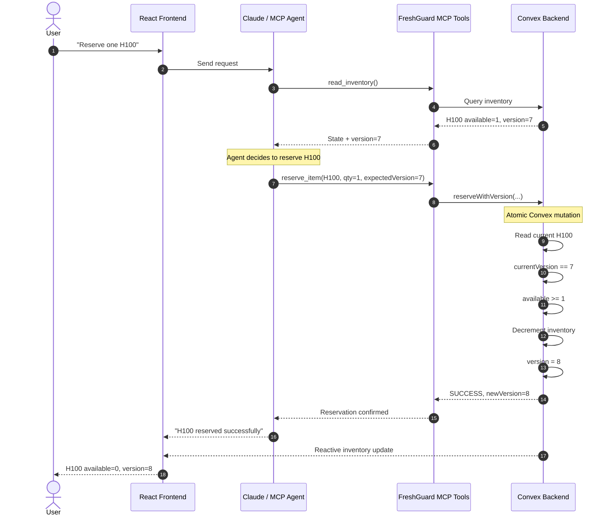
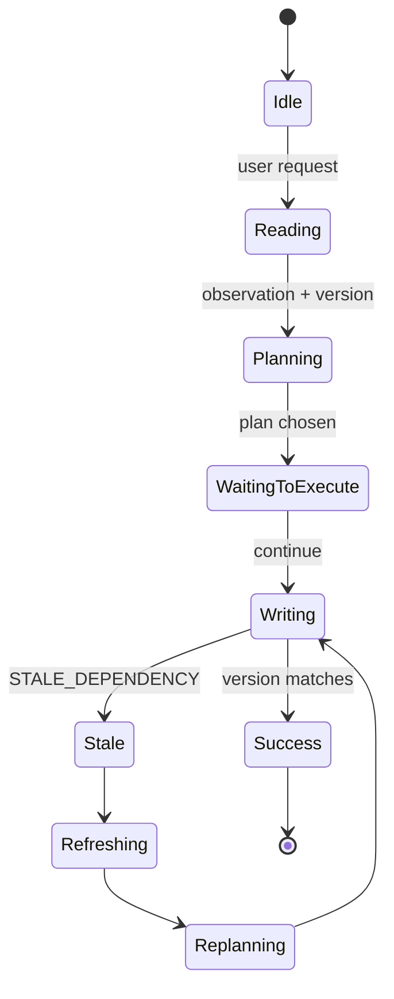

# FreshGuard — System Design

## Core architecture

```text
+-----------------------------------------------------+
|                    React / Vite                     |
|                                                     |
|  LEFT                           RIGHT               |
|  Inventory dashboard           Agent chat          |
|                                                     |
|  H100  [1] v7                  User prompt          |
|  A100  [2] v3                  Agent trace          |
|                                                     |
|  [Simulate Other Buyer]         FreshGuard status   |
+--------------+----------------------+---------------+
               |                      |
          Convex React           Agent service
               |                      |
               v                      v
       +--------------+      +-----------------+
       |    Convex    |<-----|   MCP tools     |
       |              |      |                 |
       | inventory    |      | read_inventory  |
       | transactions |      | reserve_item    |
       +--------------+      +--------+--------+
                                     |
                                     v
                                  Claude
```

## Successful transaction sequence



## Stale transaction sequence

```mermaid
sequenceDiagram
    autonumber

    actor U as User
    participant UI as React Frontend
    participant A as Claude / MCP Agent
    participant M as FreshGuard MCP Tools
    participant C as Convex Backend

    U->>UI: "Reserve H100; otherwise A100"
    UI->>A: Send request

    A->>M: read_inventory()
    M->>C: Query inventory
    C-->>M: H100 available=1, version=7
    M-->>A: H100 @ version 7

    Note over A: Agent plans: reserve H100
    Note over UI,A: DEMO PAUSE

    U->>UI: Click "Simulate Other Buyer"
    UI->>C: externalReserve(H100)

    Note over C: Another transaction
    C->>C: available 1 -> 0
    C->>C: version 7 -> 8

    C-->>UI: H100 available=0, version=8

    A->>M: reserve_item(H100, expectedVersion=7)
    M->>C: reserveWithVersion(H100, 7)

    Note over C: Atomic validation
    C->>C: currentVersion=8
    C->>C: expectedVersion=7

    C-->>M: STALE_DEPENDENCY
    M-->>A: STALE_DEPENDENCY expected=7 current=8

    Note over A: Refresh, do NOT blindly retry

    A->>M: read_inventory()
    M->>C: Query current state
    C-->>M: H100=0/v8, A100=2/v3
    M-->>A: Fresh state

    Note over A: Replan: reserve A100

    A->>M: reserve_item(A100, expectedVersion=3)
    M->>C: reserveWithVersion(A100, 3)

    C->>C: version matches
    C->>C: reserve A100
    C->>C: version 3 -> 4

    C-->>M: SUCCESS
    M-->>A: A100 reserved
    A-->>UI: "H100 changed while I was planning. I refreshed and reserved A100 instead."
```

## Agent state machine



## Design rule

FreshGuard must enforce:

```text
READ state + version
        |
        v
Agent reasons
        |
        v
WRITE expectedVersion
        |
        v
Same Convex mutation:
- read current state
- compare version
- commit or abort
```

Do not split the check and the write across separate backend operations.
