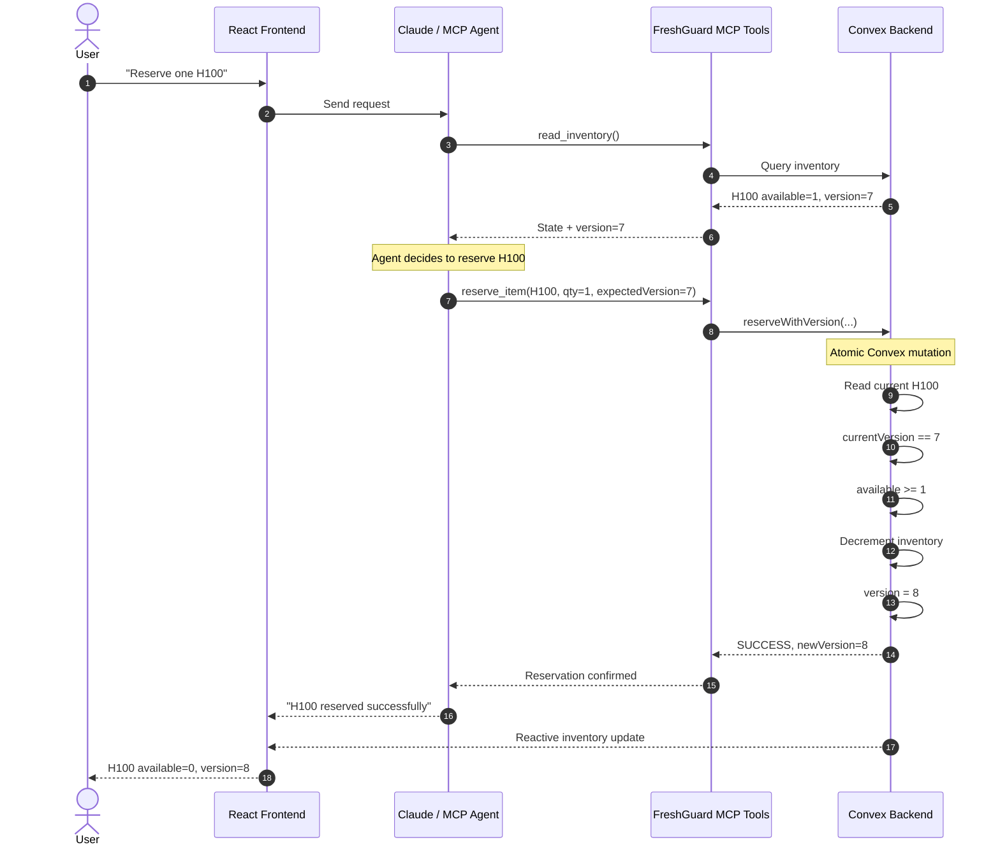
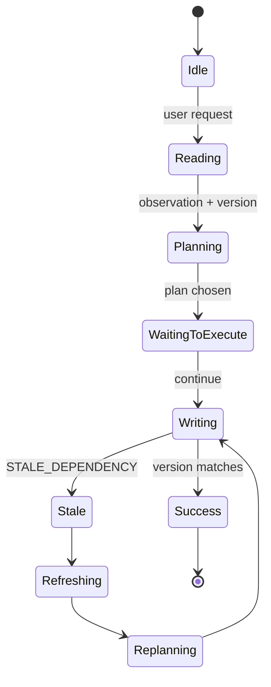

# FreshGuard — Complete 5-Hour Execution Blueprint

# FreshGuard — 5-Hour Hackathon Execution Blueprint

FreshGuard prevents AI agents from acting on facts that are no longer true.

> **Transactional consistency for MCP agents.**

## Core invariant

```text
COMMIT <=> V_observed = V_current
```

Otherwise:

```text
ABORT -> STALE_DEPENDENCY -> REFRESH -> REPLAN
```

## Recommended stack

- React + Vite
- Convex
- Anthropic Claude
- MCP
- TypeScript / Node.js

## Important implementation choices

- Use an explicit integer `version` field.
- Do **not** use `_creationTime` as an update-version token.
- Keep the version check and state-changing write inside the **same Convex mutation**.
- The agent should refresh and replan after `STALE_DEPENDENCY`, not blindly retry.

## Files

- `01_system_design.md`
- `02_user_stories_and_demo.md`
- `03_build_plan.md`
- `04_schema_and_core_logic.md`
- `05_slide_outline.md`
- `06_agent_and_mcp_contracts.md`
- `FreshGuard_Execution_Blueprint.md`

## References

Convex document types:

https://docs.convex.dev/database/types

Convex mutations:

https://docs.convex.dev/functions/mutation-functions

Convex OCC:

https://docs.convex.dev/database/advanced/occ

Convex React:

https://docs.convex.dev/client/react/overview

Convex best practices:

https://docs.convex.dev/understanding/best-practices

MCP TypeScript SDK:

https://ts.sdk.modelcontextprotocol.io/v2/

Anthropic model deprecations:

https://docs.anthropic.com/en/docs/about-claude/model-deprecations


---

# FreshGuard — System Design

## Core architecture

```text
+-----------------------------------------------------+
|                    React / Vite                     |
|                                                     |
|  LEFT                           RIGHT               |
|  Inventory dashboard           Agent chat          |
|                                                     |
|  H100  [1] v7                  User prompt          |
|  A100  [2] v3                  Agent trace          |
|                                                     |
|  [Simulate Other Buyer]         FreshGuard status   |
+--------------+----------------------+---------------+
               |                      |
          Convex React           Agent service
               |                      |
               v                      v
       +--------------+      +-----------------+
       |    Convex    |<-----|   MCP tools     |
       |              |      |                 |
       | inventory    |      | read_inventory  |
       | transactions |      | reserve_item    |
       +--------------+      +--------+--------+
                                     |
                                     v
                                  Claude
```

## Successful transaction sequence



## Stale transaction sequence

```mermaid
sequenceDiagram
    autonumber

    actor U as User
    participant UI as React Frontend
    participant A as Claude / MCP Agent
    participant M as FreshGuard MCP Tools
    participant C as Convex Backend

    U->>UI: "Reserve H100; otherwise A100"
    UI->>A: Send request

    A->>M: read_inventory()
    M->>C: Query inventory
    C-->>M: H100 available=1, version=7
    M-->>A: H100 @ version 7

    Note over A: Agent plans: reserve H100
    Note over UI,A: DEMO PAUSE

    U->>UI: Click "Simulate Other Buyer"
    UI->>C: externalReserve(H100)

    Note over C: Another transaction
    C->>C: available 1 -> 0
    C->>C: version 7 -> 8

    C-->>UI: H100 available=0, version=8

    A->>M: reserve_item(H100, expectedVersion=7)
    M->>C: reserveWithVersion(H100, 7)

    Note over C: Atomic validation
    C->>C: currentVersion=8
    C->>C: expectedVersion=7

    C-->>M: STALE_DEPENDENCY
    M-->>A: STALE_DEPENDENCY expected=7 current=8

    Note over A: Refresh, do NOT blindly retry

    A->>M: read_inventory()
    M->>C: Query current state
    C-->>M: H100=0/v8, A100=2/v3
    M-->>A: Fresh state

    Note over A: Replan: reserve A100

    A->>M: reserve_item(A100, expectedVersion=3)
    M->>C: reserveWithVersion(A100, 3)

    C->>C: version matches
    C->>C: reserve A100
    C->>C: version 3 -> 4

    C-->>M: SUCCESS
    M-->>A: A100 reserved
    A-->>UI: "H100 changed while I was planning. I refreshed and reserved A100 instead."
```

## Agent state machine



## Design rule

FreshGuard must enforce:

```text
READ state + version
        |
        v
Agent reasons
        |
        v
WRITE expectedVersion
        |
        v
Same Convex mutation:
- read current state
- compare version
- commit or abort
```

Do not split the check and the write across separate backend operations.


---

# FreshGuard — User Stories and 2-Minute Demo

## User Story 1 — Normal reservation

> As a user, I want the agent to reserve inventory when the state it observed is still current.

Acceptance:

```text
Read version = 7
Current version = 7
-> commit
```

---

## User Story 2 — Detect stale state

> As a user, I want the system to prevent an agent from acting on outdated information.

Acceptance:

```text
Read version = 7
Current version = 8
-> no write
-> STALE_DEPENDENCY
```

---

## User Story 3 — Recover intelligently

> As a user, I want the agent to refresh and replan instead of blindly retrying the same stale action.

Correct:

```text
STALE_DEPENDENCY
        |
        v
read_inventory()
        |
        v
new state
        |
        v
new reasoning
        |
        v
new write
```

Incorrect:

```text
STALE_DEPENDENCY
        |
        v
retry(H100, version=7)
```

---

## User Story 4 — Make the race visible

> As a judge, I want to clearly see why the first action was rejected.

UI should show:

```text
OBSERVED VERSION       CURRENT VERSION

       7        !=            8

               STALE
```

---

# 2-Minute Live Demo Script

## Screen layout

Left 55%:

```text
LIVE WORLD STATE
------------------------

H100 GPU
Available       1
Price           $5/hr
Version         7

[ Simulate Other Buyer ]

A100 GPU
Available       2
Price           $3/hr
Version         3
```

Right 45%:

```text
FRESHGUARD AGENT
------------------------

Chat

Agent trace

READ
PLAN
WRITE
STALE
REFRESH
REPLAN
SUCCESS
```

Header:

```text
FreshGuard
Transactional consistency for AI agents
```

---

## 0:00-0:15 — Explain the problem

Say:

> "AI agents read the world, spend time reasoning, and then act. But the world can change while they're thinking."

Do not explain Convex yet.

---

## 0:15-0:30 — Show current state

Point to:

```text
H100
Available: 1
Version: 7
```

Say:

> "This H100 is currently available, and the state is version seven."

---

## 0:30-0:45 — Give Claude the task

Prompt:

```text
Reserve one H100 GPU.

If the H100 is no longer available,
reserve one A100 instead.
```

Agent trace:

```text
READ OK

H100
available = 1
version = 7

Plan:
Reserve H100.
```

The app should now pause at:

```text
PLAN READY
Waiting to execute...

[ Continue Agent ]
```

You can say:

> "I'm pausing here just to make the concurrency race visible."

---

## 0:45-1:00 — Change reality

Before clicking Continue:

Click:

```text
SIMULATE OTHER BUYER
```

Left side changes:

```text
H100

Available
1 -> 0

Version
7 -> 8
```

Say:

> "Another user just reserved it. But Claude doesn't know that yet. Version seven is still in its context."

---

## 1:00-1:15 — Trigger stale write

Click:

```text
Continue Agent
```

Agent attempts:

```text
reserve_item(
    H100,
    expectedVersion=7
)
```

Show:

```text
+----------------------------+
|  STALE_DEPENDENCY          |
|                            |
|  observed: 7               |
|  current:  8               |
|                            |
|  WRITE ABORTED             |
+----------------------------+
```

This is the core demo moment.

---

## 1:15-1:35 — Recovery

Agent trace:

```text
STALE_DEPENDENCY

-> refresh required

read_inventory()

H100
available = 0
version = 8

A100
available = 2
version = 3

-> replan

Reserve A100
```

Then:

```text
reserve_item(
    A100,
    expectedVersion=3
)

SUCCESS
```

Left UI:

```text
A100
available 2 -> 1
version   3 -> 4
```

---

## 1:35-1:50 — Explain

Say:

> "We didn't ask Claude to remember to double-check. The database made the stale decision impossible to commit."

---

## 1:50-2:00 — Finish

Say:

> "Firewalls ask whether an agent is allowed to act. FreshGuard asks whether the facts that justified the action are still true."

Stop there.


---

# FreshGuard — 5-Hour Build Plan

## Priority order

```text
1. Transaction guard
2. Deterministic demo
3. Visible error
4. Agent recovery
5. Appearance
```

---

# T-5:00 -> T-4:45
## Project setup — 15 min

Suggested structure:

```text
freshguard/
├── convex/
│   ├── schema.ts
│   └── inventory.ts
│
├── src/
│   ├── App.tsx
│   ├── InventoryPanel.tsx
│   ├── AgentPanel.tsx
│   └── main.tsx
│
├── agent/
│   ├── server.ts
│   ├── mcp.ts
│   └── systemPrompt.ts
│
└── package.json
```

Install:

```bash
npm create vite@latest
npm install
npm install convex
npm install @anthropic-ai/sdk
npm install @modelcontextprotocol/server
npm install @modelcontextprotocol/client
npm install zod
```

Then:

```bash
npx convex dev
```

Do not style yet.

---

# T-4:45 -> T-3:45
## Core transaction mechanism — 60 min

Implement:

```text
schema
-> seed
-> read
-> externalReserve
-> reserveWithVersion
-> STALE_DEPENDENCY
```

Before touching Claude, prove this manually.

### Test A

```text
read H100
version=1

reserve expectedVersion=1

SUCCESS
```

### Test B

Reset.

```text
read H100
version=1

externalReserve H100
version becomes 2

reserve expectedVersion=1

STALE_DEPENDENCY
```

If this is not working after one hour:

> Do not build anything else until it works.

---

# T-3:45 -> T-3:10
## Dashboard — 35 min

Build:

```text
InventoryPanel
```

Use Convex React hooks:

```ts
useQuery(...)
useMutation(...)
```

Display:

```text
name
available
price
version
```

Add:

```text
[ Simulate Other Buyer ]
[ Reset Demo ]
```

Do not build:

- login
- settings
- navigation
- account management

---

# T-3:10 -> T-2:25
## MCP tools — 45 min

Expose exactly two tools:

```text
read_inventory
reserve_inventory
```

No more.

### read_inventory

Input:

```json
{}
```

Output:

```json
{
  "items": [
    {
      "id": "...",
      "sku": "H100",
      "available": 1,
      "pricePerHour": 5,
      "version": 7
    }
  ]
}
```

### reserve_inventory

Input:

```json
{
  "itemId": "...",
  "quantity": 1,
  "expectedVersion": 7
}
```

Success:

```json
{
  "success": true,
  "newVersion": 8
}
```

Stale:

```json
{
  "error": "STALE_DEPENDENCY",
  "expectedVersion": 7,
  "currentVersion": 8,
  "requiredAction": "READ_AND_REPLAN"
}
```

Do not return a generic `retry=true`.

Recovery is:

```text
refresh + replan
```

---

# T-2:25 -> T-1:35
## Claude agent — 50 min

System prompt rules:

```text
You are the FreshGuard reservation agent.

Rules:

1. Before making a reservation, call read_inventory.

2. Every reservation must use the exact version returned
   by read_inventory as expectedVersion.

3. If reserve_inventory returns STALE_DEPENDENCY,
   NEVER retry the same reservation with the same version.

4. Call read_inventory again.

5. Re-evaluate the user's goal using the new state.

6. Only then make another reservation attempt.

Explain stale recovery briefly to the user.
```

Do not spend a long time prompt-engineering.

---

# T-1:35 -> T-1:00
## Split-screen UI + trace — 35 min

Right panel should show execution cards.

Example:

```text
READ OK

H100
available: 1
version: 7
```

Then:

```text
PLAN

Reserve H100
based on version 7
```

Then:

```text
STALE_DEPENDENCY

observed 7
current 8

Action blocked.
```

Then:

```text
REFRESH
```

Then:

```text
REPLAN

H100 unavailable.
Selecting A100.
```

Then:

```text
COMMIT OK
```

---

# T-1:00 -> T-0:40
## Make the race deterministic — 20 min

Add a demo barrier:

```text
Agent has planned action

[ Continue Agent ]
```

Internal state machine:

```text
IDLE
-> READING
-> PLANNED
-> WAITING_FOR_EXECUTION
-> WRITING
-> STALE
-> REFRESHING
-> REPLANNING
-> SUCCESS
```

Do not rely on Claude taking long enough naturally.

---

# T-0:40 -> T-0:20
## Test 10 times — 20 min

Only two scenarios matter.

### Scenario A — normal control

```text
read
-> no external change
-> reserve H100
-> success
```

### Scenario B — FreshGuard

```text
read H100 @7
-> external change
-> H100 @8
-> stale write rejected
-> reread
-> select A100
-> success
```

---

# T-0:20 -> T-0:00
## Demo prep — 20 min

Prepare:

- browser already open
- Convex running
- agent server running
- API keys loaded
- data reset
- zoom readable
- terminal hidden
- slides ready
- backup screenshots/video
- large Reset Demo button

---

# Hard scope cuts

Cut first:

```text
animations
themes
authentication
audit history
multiple users
multiple resource types
fancy MCP abstractions
deployment
mobile layout
charts
settings
```

Never cut:

```text
explicit version
atomic check
STALE_DEPENDENCY
refresh
replan
visible demo
```

---

# Success criteria

You are finished when this works reliably 10/10 times:

```text
1. Reset.

2. Ask:
   "Reserve H100, otherwise A100."

3. Agent reads H100 @ v1.

4. Pause.

5. Click "Simulate Other Buyer."

6. H100 becomes:
   available=0
   version=2.

7. Continue.

8. FreshGuard visibly rejects:
   expected=1
   current=2.

9. Claude refreshes.

10. Claude chooses A100.

11. A100 reservation succeeds.

12. UI updates live.
```


---

# FreshGuard — Convex Schema and Core Logic

## Important rule

Use an explicit integer `version` field.

Do not use `_creationTime` as a mutable version token.

Convex document types reference:

https://docs.convex.dev/database/types

---

# `convex/schema.ts`

```ts
import { defineSchema, defineTable } from "convex/server";
import { v } from "convex/values";

export default defineSchema({
  inventory: defineTable({
    sku: v.string(),
    name: v.string(),
    available: v.number(),
    pricePerHour: v.number(),

    // FreshGuard dependency version.
    // Increment on every meaningful state change.
    version: v.number(),
  }).index("by_sku", ["sku"]),
});
```

---

# `convex/inventory.ts`

```ts
import { ConvexError, v } from "convex/values";
import { mutation, query } from "./_generated/server";

/**
 * Live inventory displayed by React and exposed to the agent.
 */
export const list = query({
  args: {},

  handler: async (ctx) => {
    return await ctx.db.query("inventory").collect();
  },
});

/**
 * Seed/reset the deterministic demo state.
 */
export const resetDemo = mutation({
  args: {},

  handler: async (ctx) => {
    const existing = await ctx.db.query("inventory").collect();

    for (const item of existing) {
      await ctx.db.delete("inventory", item._id);
    }

    const h100Id = await ctx.db.insert("inventory", {
      sku: "H100",
      name: "NVIDIA H100",
      available: 1,
      pricePerHour: 5,
      version: 1,
    });

    const a100Id = await ctx.db.insert("inventory", {
      sku: "A100",
      name: "NVIDIA A100",
      available: 2,
      pricePerHour: 3,
      version: 1,
    });

    return {
      h100Id,
      a100Id,
    };
  },
});

/**
 * Represents another user/process changing the world
 * while Claude is reasoning.
 */
export const simulateExternalReservation = mutation({
  args: {
    itemId: v.id("inventory"),
    quantity: v.number(),
  },

  handler: async (ctx, args) => {
    const item = await ctx.db.get("inventory", args.itemId);

    if (!item) {
      throw new ConvexError({
        code: "ITEM_NOT_FOUND",
      });
    }

    if (item.available < args.quantity) {
      throw new ConvexError({
        code: "INSUFFICIENT_INVENTORY",
        available: item.available,
        requested: args.quantity,
      });
    }

    await ctx.db.patch("inventory", args.itemId, {
      available: item.available - args.quantity,
      version: item.version + 1,
    });

    return {
      success: true,
      newVersion: item.version + 1,
    };
  },
});

/**
 * FreshGuard guarded commit.
 *
 * Important:
 * - Read CURRENT state.
 * - Validate expected version.
 * - Perform write.
 *
 * All inside the SAME Convex mutation.
 */
export const reserveWithVersion = mutation({
  args: {
    itemId: v.id("inventory"),
    quantity: v.number(),
    expectedVersion: v.number(),
  },

  handler: async (ctx, args) => {
    const item = await ctx.db.get("inventory", args.itemId);

    if (!item) {
      throw new ConvexError({
        code: "ITEM_NOT_FOUND",
      });
    }

    // FreshGuard check
    if (item.version !== args.expectedVersion) {
      throw new ConvexError({
        code: "STALE_DEPENDENCY",
        itemId: args.itemId,
        sku: item.sku,
        expectedVersion: args.expectedVersion,
        currentVersion: item.version,
        requiredAction: "READ_AND_REPLAN",
      });
    }

    // Normal business invariant
    if (item.available < args.quantity) {
      throw new ConvexError({
        code: "INSUFFICIENT_INVENTORY",
        available: item.available,
        requested: args.quantity,
      });
    }

    const newVersion = item.version + 1;

    await ctx.db.patch("inventory", args.itemId, {
      available: item.available - args.quantity,
      version: newVersion,
    });

    return {
      success: true,
      sku: item.sku,
      reserved: args.quantity,
      remaining: item.available - args.quantity,
      newVersion,
    };
  },
});
```

---

# Why this is atomic

The relevant logic:

```ts
const item = await ctx.db.get("inventory", args.itemId);

if (item.version !== args.expectedVersion) {
  throw ...
}

await ctx.db.patch(...);
```

is one Convex mutation.

It is **not**:

```text
transaction 1: check
transaction 2: write
```

Convex mutation docs:

https://docs.convex.dev/functions/mutation-functions

OCC docs:

https://docs.convex.dev/database/advanced/occ

---

# Dangerous implementation

Do not do this:

```ts
const current = await convex.query(...);

if (current.version === expectedVersion) {
  // TIME PASSES HERE
  await convex.mutation(reserveWithoutCheckingAgain);
}
```

That creates:

```text
CHECK
|
v
world changes
|
v
ACT
```

The check must be in the same mutation as the write.

---

# Core invariant

```text
COMMIT <=> V_observed = V_current
```

Else:

```text
STALE_DEPENDENCY
```

---

# Optional multi-resource dependency design

If time allows:

```json
{
  "dependencies": [
    {
      "resource": "inventory:H100",
      "version": 7
    },
    {
      "resource": "budget:user123",
      "version": 12
    },
    {
      "resource": "policy:gpuReservation",
      "version": 4
    }
  ]
}
```

Before commit:

```text
inventory   7 == 7   OK
budget     12 == 13  STALE
policy      4 == 4   OK

STALE_DEPENDENCY
resource = budget
```

This is the path from a single-row optimistic version check to a general **agent dependency validation protocol**.


---

# FreshGuard — 4-Slide Presentation Outline

Keep the slides sparse.

---

# Slide 1 — Problem

## **AI agents act on yesterday's truth**

```text
READ
"1 GPU available"

        |
        v

THINK

        |
        v

WORLD CHANGES

        |
        v

ACT
"Reserve GPU"
```

Bottom line:

> **The model's context is a snapshot. The world isn't.**

Optional benchmark reference from the earlier FreshGuard research:

https://arxiv.org/abs/2610.05281

---

# Slide 2 — Solution

## **FreshGuard**

```text
READ

state + version 7

       |
       v

Claude reasons

       |
       v

WRITE
expected version 7

       |
       v

ATOMIC CHECK

7 == current?
```

Then:

```text
YES -> COMMIT

NO  -> STALE_DEPENDENCY
       REFRESH
       REPLAN
```

Bottom:

> **Correctness enforced by the transaction, not the prompt.**

---

# Slide 3 — Demo

## **Watch reality change while Claude is thinking**

Box 1:

```text
Claude sees:
H100 available
version 7
```

Box 2:

```text
Another user reserves it:
version 8
```

Box 3:

```text
FreshGuard:
BLOCK -> REFRESH -> A100
```

Then stop presenting and demo.

---

# Slide 4 — Market / Future

## **Consistency infrastructure for autonomous agents**

Today:

```text
Inventory
Bookings
Payments
CRM
Calendars
Workflow state
```

Tomorrow:

```text
Multi-resource dependency sets

GPU     @ v17
Budget  @ v9
Policy  @ v22
```

Bottom:

> **Cache coherence for AI agents.**

Differentiation line:

> **Firewalls decide whether an agent may act. FreshGuard verifies whether the facts authorizing the action are still true.**


---

# FreshGuard — Agent Prompt and MCP Contracts

## MCP tools

Expose exactly two tools for the hackathon.

---

# `read_inventory`

Input:

```json
{}
```

Output:

```json
{
  "items": [
    {
      "id": "abc",
      "sku": "H100",
      "name": "NVIDIA H100",
      "available": 1,
      "pricePerHour": 5,
      "version": 7
    },
    {
      "id": "xyz",
      "sku": "A100",
      "name": "NVIDIA A100",
      "available": 2,
      "pricePerHour": 3,
      "version": 3
    }
  ]
}
```

---

# `reserve_inventory`

Input:

```json
{
  "itemId": "abc",
  "quantity": 1,
  "expectedVersion": 7
}
```

Success:

```json
{
  "success": true,
  "sku": "H100",
  "reserved": 1,
  "newVersion": 8
}
```

Stale:

```json
{
  "error": "STALE_DEPENDENCY",
  "expectedVersion": 7,
  "currentVersion": 8,
  "requiredAction": "READ_AND_REPLAN"
}
```

Do not communicate the error as a generic transient retry.

Correct:

```text
REFRESH -> REASON -> NEW ACTION
```

Incorrect:

```text
FAILED -> RETRY SAME CALL
```

---

# Suggested agent system prompt

```text
You are FreshGuard, an inventory reservation agent.

You have access to:
- read_inventory
- reserve_inventory

Rules:

1. Always read inventory before making a reservation.

2. Treat the version returned by read_inventory as a
   dependency of any decision based on that item.

3. When calling reserve_inventory, pass the exact version
   from the observation used to make your decision.

4. If reserve_inventory returns STALE_DEPENDENCY:
   - do not retry the same call,
   - do not reuse the old version,
   - call read_inventory again,
   - reconsider the user's goal using the new state,
   - make a new plan.

5. When stale state is detected, briefly explain what changed.

6. Prefer completing the user's original intent using a valid
   alternative rather than failing immediately.
```

---

# Recommended React hierarchy

```text
App
├── Header
│   ├── FreshGuard
│   └── Transactional consistency for AI agents
│
├── Demo
│   ├── InventoryPanel
│   │   ├── H100 card
│   │   ├── A100 card
│   │   ├── Simulate Other Buyer
│   │   └── Reset Demo
│   │
│   └── AgentPanel
│       ├── Chat
│       ├── ToolTrace
│       ├── FreshnessStatus
│       └── ContinueAgentButton
│
└── Footer
    └── COMMIT <=> observed_version == current_version
```

---

# Visual semantics

Use colors only for state meaning.

```text
GREEN
FRESH
SUCCESS

RED
STALE
ABORTED

AMBER
REFRESH
REPLAN
```

Versions should always remain visible.

Example:

```text
H100

Available          1
Version             7

FRESH
```

After change:

```text
Available          0
Version             8

UPDATED
```

Agent trace:

```text
OBSERVED     CURRENT

   v7     !=    v8

STALE DEPENDENCY
WRITE ABORTED
```

That visualization should explain the idea without requiring a long verbal explanation.


---
